# Factchecker Command Flow

```mermaid
%%{init: {
  'theme': 'base', 
  'themeVariables': { 
    'fontSize': '18px', 
    'fontFamily': 'arial', 
    'primaryTextColor': '#000000',
    'primaryColor': '#e0e0e0',
    'lineColor': '#2050c0',
    'primaryBorderColor': '#2050c0',
    'edgeLabelBackground': '#ffffff',
    'tertiaryColor': '#ffffff',
    'tertiaryBorderColor': '#2050c0',
    'lineWidth': '3px',
    'nodeBorder': '#000000',
    'clusterBkg': 'rgba(240, 240, 255, 0.9)',
    'clusterBorder': '#2050c0',
    'titleColor': '#000000',
    'subGraphBackground': 'rgba(240, 240, 255, 0.7)',
    'subGraphBorder': '#2050c0'
  }
}}%%
flowchart TD
    %% Main nodes
    Start([START]) --> CommandInit["Initialize factchecker command
    (Command.__init__)
    Uses Django settings for API keys"]
    CommandInit --> ParseArgs["Parse command arguments
    (Command.add_arguments)"]
    ParseArgs --> QueryInput["Process user query input
    (Command.handle)"]
    
    %% Search phase
    QueryInput --> SearchMethodSelect{"Search method?
    (Command.handle)"}
    SearchMethodSelect -->|vector| VectorSearch["Vector search using OpenAI embeddings
    (vector_search_datasets)
    AI: text-embedding-3-small model for semantic similarity
    Uses Django settings for API keys"]
    SearchMethodSelect -->|keyword| KeywordSearch["Keyword search using Data.gov API
    (search_datasets)"]
    
    %% Dataset discovery
    VectorSearch --> RankDatasets["Rank datasets by similarity score
    (Command.handle)"]
    KeywordSearch --> RankDatasets
    RankDatasets --> FilterTopN["Filter top N datasets (--top parameter)
    (Command.handle)"]
    
    %% Processing mode decision
    FilterTopN --> ProcessingMode{"Sequential?
    (Command.handle)"}
    ProcessingMode -->|Yes| SequentialProcessing["Process datasets one by one
    (Command.handle)"]
    ProcessingMode -->|No| ParallelProcessing["Process datasets in parallel
    (ThreadPoolExecutor)"]
    
    %% Dataset download loop
    subgraph DownloadLoop["For each dataset in selected datasets (process_dataset)"]
        DownloadStart([Dataset Processing Start]) --> PrepareDownload["Prepare download parameters
        (process_dataset)"]
        PrepareDownload --> DownloadAttempt["Attempt to download dataset
        (download_all_resources)
        Note: Downloads ALL eligible files (CSV/Excel/PDF) from dataset"]
        DownloadAttempt --> DownloadCheck{"Download successful?"}
        DownloadCheck -->|No| DownloadRetry{"Retry attempts left?"}
        DownloadRetry -->|Yes| DownloadAttempt
        DownloadRetry -->|No| DownloadFail["Log failure and skip dataset"]
        DownloadCheck -->|Yes| MultiFileCheck{"Multiple files?"}
        MultiFileCheck -->|Yes| AnalyzeMultipleFiles["Analyze multiple files
        (analyze_dataset_files)
        AI: Analyzes all files and creates combined summary"]
        MultiFileCheck -->|No| ProcessFile["Process downloaded file
        (load_datafile)"]
        AnalyzeMultipleFiles --> ProcessFile
        ProcessFile --> ParseFileType["Determine file type (CSV, JSON, etc)
        (load_datafile)"]
        ParseFileType --> ExtractData["Extract data from file
        (load_datafile, load_pdf_document)
        AI: For PDFs, uses OpenAI/Azure to generate enhanced summaries"]
        ExtractData --> AssessRelevance["Assess relevance to query (second check)
        (assess_dataset_relevance)
        AI: Uses OpenAI/Azure to evaluate dataset relevance to query"]
        AssessRelevance --> RelevanceCheck{"Meets threshold?
        (relevance_score >= threshold)"}
        RelevanceCheck -->|No| SkipDataset["Skip dataset"]
        RelevanceCheck -->|Yes| StoreResults["Store extracted data
        (extract_relevant_data)"]
        
        %% Extraction subgraph
        subgraph ExtractionProcess["Data Extraction Process (extract_relevant_data)"]
            IdentifyColumns["Identify relevant columns
            (identify_relevant_columns)
            AI: GPT-4o/Azure OpenAI analyzes columns for relevance to query"]
            
            ColumnLoop["LOOP through relevant columns"]
            
            AnalyzeValues["Analyze unique values in each column
            (get_unique_column_values)"]
            
            SelectRelevantValues["Select relevant values
            (select_relevant_values)
            AI: GPT-4o/Azure OpenAI identifies values relevant to query"]
            
            GenerateCode["Generate extraction code
            (generate_extraction_code)
            AI: GPT-4o/Azure OpenAI creates pandas code to extract data"]
            
            DetermineStrategy["Determine extraction strategy
            (determine_extraction_strategy)
            AI: GPT-4o/Azure OpenAI creates plan for data extraction"]
            
            ExecutePlan["Execute extraction plan
            (execute_extraction_plan)"]
            
            ValidationLoop["LOOP: Validation feedback loop (max 3 attempts)"]
            
            ExecuteCode["Execute generated code
            (execute_code)"]
            
            ValidateResults["Validate extraction results
            (validate_extraction_results)
            AI: GPT-4o/Azure OpenAI validates extraction quality"]
            
            ValidationCheck{"Results valid?"}
            
            ImproveCode["Generate improved code
            (generate_improved_code)
            AI: GPT-4o/Azure OpenAI improves extraction code"]
            
            IdentifyColumns --> ColumnLoop
            ColumnLoop --> AnalyzeValues
            AnalyzeValues --> SelectRelevantValues
            SelectRelevantValues --> ColumnLoop
            ColumnLoop --> GenerateCode
            GenerateCode --> DetermineStrategy
            DetermineStrategy --> ExecutePlan
            ExecutePlan --> ValidationLoop
            ValidationLoop --> ExecuteCode
            ExecuteCode --> ValidateResults
            ValidateResults --> ValidationCheck
            ValidationCheck -->|No| ImproveCode
            ImproveCode --> ValidationLoop
            ValidationCheck -->|Yes| ExtractionComplete["Return extracted data"]
        end
        
        StoreResults --> ExtractionProcess
        ExtractionProcess --> PreviewCheck
        
        PreviewCheck{"Preview flag?"}
        PreviewCheck -->|Yes| ShowPreview["Display data preview
        (Command.display_extracted_data)"]
        PreviewCheck -->|No| DownloadEnd([Dataset Processing End])
        ShowPreview --> DownloadEnd
        SkipDataset --> DownloadEnd
        DownloadFail --> DownloadEnd
    end
    
    %% Connect processing modes to download loop
    SequentialProcessing --> DownloadLoop
    ParallelProcessing --> DownloadLoop
    
    %% Post-download processing
    DownloadLoop --> AggregateFindingsStart["Begin aggregating findings
    (Command.handle)"]
    AggregateFindingsStart --> FilterByRelevance["Filter datasets by relevance score (--relevance-threshold)
    (Command.handle)"]
    FilterByRelevance --> AnalyzeData["Analyze extracted data
    (analyze_dataset_overview)
    From factchecker.processing.analysis module"]
    
    %% Analysis phase
    subgraph AnalysisPhase["Analysis for each relevant dataset (analyze_dataset_overview)"]
        AnalysisStart([Analysis Start]) --> CollectMetadata["Collect dataset metadata
        - Row/column counts
        - Missing values
        - Column information"]
        
        CollectMetadata --> IdentifySpecialColumns["Identify special columns
        - Temporal columns (date, year, etc.)
        - Geographic columns (city, state, etc.)
        - Categorical columns"]
        
        IdentifySpecialColumns --> AnalyzeScope["Analyze dataset scope
        - Temporal range analysis
        - Geographic scope analysis
        - Categorical value analysis"]
        
        AnalyzeScope --> ProcessExtractedData["Process extracted data
        - Include extraction strategy
        - Include extraction code
        - Include extraction results"]
        
        ProcessExtractedData --> GenerateAnalysis["Generate comprehensive analysis
        AI: GPT-4o/Azure OpenAI analyzes dataset relevance, quality, 
        limitations, and insights"]
        
        GenerateAnalysis --> AnalysisEnd([Analysis End])
    end
    
    AnalyzeData --> AnalysisPhase
    
    %% Output generation
    AnalysisPhase --> CombineResults["Combine results from all datasets
    (Command.handle)"]
    CombineResults --> GenerateFindings["Generate comprehensive findings
    (Command.handle)"]
    GenerateFindings --> JSONCheck{"JSON output?"}
    JSONCheck -->|Yes| CreateJSON["Create detailed JSON structure
    (summarize_findings_alternate)
    AI: Uses OpenAI/Azure to generate structured JSON output
    From factchecker.presentation.cli_tool_functions module"]
    JSONCheck -->|No| SimplifiedOutput["Create simplified output
    (summarize_findings)
    AI: Uses OpenAI/Azure to generate text summary
    From factchecker.presentation.cli_tool_functions module"]
    CreateJSON --> SaveJSON["Save to timestamped file
    (Command.handle)"]
    SimplifiedOutput --> DisplayResults["Display results in console
    (Command.handle)"]
    SaveJSON --> DisplayResults
    DisplayResults --> End([SUCCESS])

    %% Styling
    classDef processNode fill:#ffeeee,stroke:#cc0000,stroke-width:3px,color:#000000,rx:5
    classDef decisionNode fill:#eeffee,stroke:#00aa00,stroke-width:3px,color:#000000,rx:5
    classDef startEnd fill:#eeeeff,stroke:#0000cc,stroke-width:3px,color:#000000,rx:15
    classDef failureNode fill:#ffeeee,stroke:#cc0000,stroke-width:3px,color:#000000,rx:5
    classDef loopNode fill:#fff8e8,stroke:#ffa500,stroke-width:3px,color:#000000,rx:5
    
    class Start,End,DownloadStart,DownloadEnd,AnalysisStart,AnalysisEnd,ExtractionComplete startEnd
    class SearchMethodSelect,ProcessingMode,DownloadCheck,DownloadRetry,RelevanceCheck,PreviewCheck,JSONCheck,ValidationCheck decisionNode
    class CommandInit,ParseArgs,QueryInput,VectorSearch,KeywordSearch,RankDatasets,FilterTopN,SequentialProcessing,ParallelProcessing,PrepareDownload,DownloadAttempt,ProcessFile,ParseFileType,ExtractData,AssessRelevance,StoreResults,ShowPreview,FilterByRelevance,AnalyzeData,DetectDataTypes,GenerateStats,IdentifyPatterns,AssessConfidence,CreateSummary,CombineResults,GenerateFindings,CreateJSON,SaveJSON,SimplifiedOutput,DisplayResults,IdentifyColumns,AnalyzeValues,SelectRelevantValues,GenerateCode,DetermineStrategy,ExecutePlan,ExecuteCode,ValidateResults,ImproveCode,CollectMetadata,IdentifySpecialColumns,AnalyzeScope,ProcessExtractedData,GenerateAnalysis processNode
    class DownloadFail,SkipDataset failureNode
    class ColumnLoop,ValidationLoop loopNode
    
    linkStyle default stroke:#2050c0,stroke-width:3px

    %% Subgraph title styling
    %%{init: {
      "flowchart": {
        "htmlLabels": true,
        "curve": "basis"
      },
      "themeVariables": {}
    }}%%
```

## Viewing the Diagram

You can view this diagram in several ways:

1. **GitHub**: When committed to GitHub, the diagram will render automatically in the markdown file
2. **VS Code**: Install the "Markdown Preview Mermaid Support" extension and use the Preview feature
3. **Mermaid Live Editor**: Copy the diagram code and paste it into [Mermaid Live Editor](https://mermaid.live/)
4. **Export Options**: From the Mermaid Live Editor, you can export as SVG, PNG, or PDF